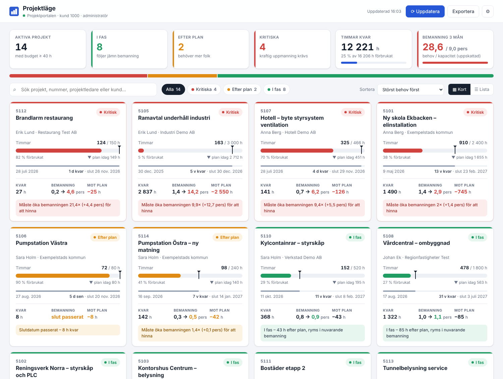
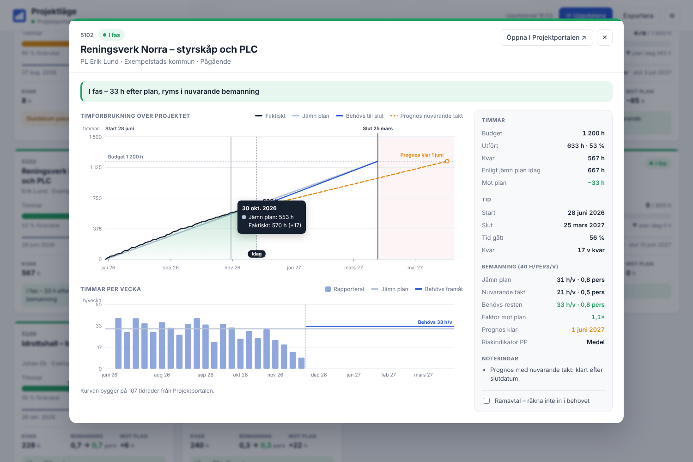
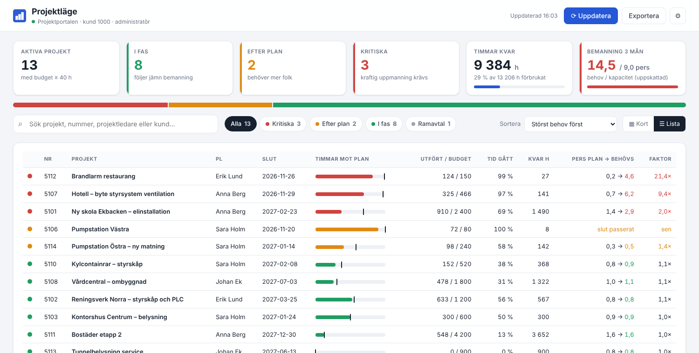

# PP Planering

Chrome-tillägg för långtidsplanering av bemanning i **Projektportalen** (`new-app.projektportalen.se`).

Visar alla stora projekt (budget ≥ 40 h, justerbart) med timmar kvar, slutdatum och hur mycket som måste mannas upp för att hinna i tid. Målet är **jämn bemanning genom hela projektet**, så att man ser tidigt om ett projekt har 2 månader och 1 500 timmar kvar.

**Tillägget läser bara data.** Det kan inte ändra något i Projektportalen (se [Säkerhet](#säkerhet)).

*Skärmbilderna visar påhittad testdata.*

**Översikt** – alla projekt som kort med status, timmar mot plan och bemanningsbehov



**Detaljvy** – förbrukningskurva från start till slut, var man är idag, timmar per vecka



**Listvy**



## Installera

1. Hämta senaste `PP-Planering-x.y.z.zip` under [Releases](https://github.com/oscarjio/pp-planering/releases/latest).
2. Packa upp zippen till en fast mapp, t.ex. `C:\dev\pp-planering-ext` (inte en OneDrive-mapp).
3. Öppna `chrome://extensions`, slå på **Utvecklarläge** uppe till höger.
4. Klicka **Läs in okomprimerat tillägg** och välj den uppackade mappen.
5. Fäst ikonen i verktygsfältet.

Uppdatera: packa upp nya zippen över samma mapp och klicka ↻ på tillägget i `chrome://extensions`.

## Använda

1. Logga in i Projektportalen i en flik (tillägget använder din inloggning).
2. Klicka på tilläggsikonen → översikten öppnas i en egen flik.
3. **Uppdatera** hämtar om data. **Exportera CSV** ger en fil för Excel.

Vad man ser beror på inloggad användares behörighet i Projektportalen. Logga in som chef/admin för att se alla projekt.

### Vyn

- **Nyckeltal** överst: antal aktiva projekt, hur många som är i fas / efter plan / kritiska (klicka för att filtrera), timmar kvar och bemanningsbehov kommande 3 månader mot kapacitet.
- **Sök, filtrera och sortera**: fritext på nummer, namn, projektledare och kund; statusfilter; sortering på behov, slutdatum, timmar kvar, budget m.m. Kort- eller listvy.
- **Projektkort**:
  - *Timmar*-stapeln visar förbrukade timmar mot budget. Den svarta markören ▼ visar var man *borde* vara idag med jämn bemanning. Stapel kortare än markören = efter plan, längre = före plan.
  - Den tunna stapeln under visar hur stor del av projekttiden som gått.
  - *Bemanning* `1,4 → 2,9 pers` = jämn plan → vad som behövs resten av projektet.
  - Raden längst ner sammanfattar läget i klartext.
- **Detaljvy** (klicka på ett kort): förbrukningskurva från start till slutdatum med jämn plan, faktiskt utfall, var man är idag, vad som behövs fram till slut och prognos med nuvarande takt. Under den: timmar per vecka mot planerad och behövd takt. Hovra för värden.
- **Bemanning framåt**: personer som behövs per månad över alla projekt mot kapacitet. Staplar över kapacitetslinjen betyder risk för att behöva hyra in.

Status: 🟢 i fas · 🟠 efter plan (bemanningen måste öka > 15 %) · 🔴 kritisk (måste öka > 50 % och minst en halv person, eller slutdatum passerat) · 🔵 före plan / tidigt överbemannat · ⚪ saknar datum.

Löpande **ramavtal** med stora timramar markeras i detaljvyn och räknas då inte in i behovet.

### Inställningar

Minsta budget, timmar per person och vecka, period för takt, kapacitet (antal personer; annars uppskattas den från Hantera tid) och gränserna för gul/röd.

### Nuvarande takt – varifrån?

1. **Historik:** vid varje uppdatering sparas utfört per projekt lokalt i webbläsaren. Efter en vecka räknas takten fram ur den. Det fungerar för alla roller.
2. **Tidrader per projekt**, om rollen har behörighet.
3. **Hantera tid** (veckoöversikt) som sista utväg.

## Säkerhet

- All trafik går via `content.js`, som har en **allowlist** med endast läsande anrop: `GET` mot risk-scores, projektdetalj, time-manage och scheman samt `POST` mot två list-endpoints som bara läser. Allt annat (PUT/DELETE/andra POST) blockeras.
- Inget lösenord eller token lagras. Tillägget använder webbläsarens befintliga session och CSRF-token från Projektportalen.
- Ingen data skickas någon annanstans än till Projektportalen.

## Utveckling

```
extension/
  manifest.json      MV3
  background.js      öppnar översikten
  content.js         skrivskyddad API-proxy i Projektportalen-fliken
  dashboard.*        översiktssidan
  lib/calc.js        beräkningar (ren logik)
  lib/data.js        datainhämtning
  lib/charts.js      SVG-diagram
test/calc.test.js    node --test test/calc.test.js
test/e2e_extension.py  end-to-end i Chromium mot simulerat API (se filhuvud)
```

Release: pusha en tagg `vX.Y.Z` → GitHub Actions kör testerna, sätter versionen i manifestet, zippar `extension/` och lägger zippen på releasen.

API-kartläggningen finns i `docs/projektportalen-api-v2.md`. Projektportalens API är inofficiellt och kan ändras utan förvarning.
